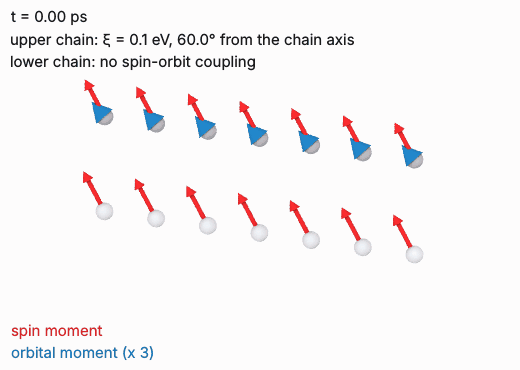
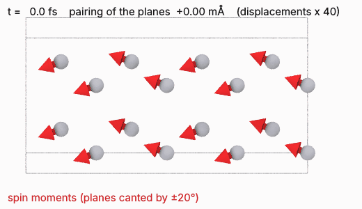

# bopjax

A fresh JAX implementation of the analytic bond-order-potential (BOP)
methodology implemented by BOPfox. The energy is one differentiable function;
forces, stress, magnetic torques and the self-consistency Jacobian come from
automatic differentiation instead of hand-derived chains.

## Install

As a dependency of another project, from a tagged release:

```bash
pip install "bopjax @ git+https://github.com/sebschre/bop-jax@v0.4.0"
# with the JAX-MD interface
pip install "bopjax[md] @ git+https://github.com/sebschre/bop-jax@v0.4.0"
```

or in `pyproject.toml`:

```toml
dependencies = ["bopjax @ git+https://github.com/sebschre/bop-jax@v0.4.0"]
```

Each [release](https://github.com/sebschre/bop-jax/releases) also carries a
wheel that `pip install <url>` accepts. Python 3.11 to 3.13.

To work on the code:

```bash
uv sync                 # --extra md: JAX-MD interface, --extra viz: OVITO rendering
uv run pytest           # about 3 minutes: every configuration is compiled once
uv run python examples/fcc_distorted.py
```

## Formulation

`energy(shifts, positions, cell, params)` evaluates

    E = sum U_bond + sum E0 (N - N0) + 1/2 sum_i J_ii q_i^2
        + 1/2 sum_{i != j} J_ij q_i q_j - 1/4 sum I m^2 + E_rep

where `shifts` are the changes of the onsite levels (per atom and shell, and per
spin channel when magnetic), `U_bond` and `N` come from the Chebyshev expansion
of the local density of states, and the Fermi level is fixed by the total
electron count.

- **Self-consistency** is the stationary point `dE/dshifts = 0`. This is the
  condition BOPfox solves (`BOhat - Nelec = 0`). It is solved by Newton's
  method with the exact Hessian `d2E/dshifts2` from `jacfwd(grad(E))`.
- **Forces, stress, torques, parameter gradients** are plain partial
  derivatives at that point; no response term is needed because the energy is
  stationary in the shifts.
- `make_potential` wraps the self-consistency into one compiled function
  `E(positions, cell, params)` whose `jax.grad` is the exact force.

## References

For the analytic BOP methodology and its implementation in BOPfox, see:

- R. Drautz, T. Hammerschmidt, M. Cak, and D. G. Pettifor, “Bond-order
  potentials: Derivation and parameterization for refractory elements,”
  *Modelling and Simulation in Materials Science and Engineering* 23 (2015),
  074004. [doi:10.1088/0965-0393/23/7/074004](https://doi.org/10.1088/0965-0393/23/7/074004)
- T. Hammerschmidt et al., “BOPfox program for tight-binding and analytic
  bond-order potential calculations,” [arXiv:1803.07491](https://arxiv.org/abs/1803.07491),
  [doi:10.1016/j.cpc.2018.08.013](https://doi.org/10.1016/j.cpc.2018.08.013).

See the [BOPfox website](https://bopfox.de/) for more information about the
reference program and its contributors.

## Features

| Feature | Options |
|---|---|
| Basis | s, p, d shells in any combination, several species |
| Bond integrals | power law, BOPfox `v0`; any `radial(p, r)` callable |
| Bandwidth | `azero`, `lowest`, `highest`, `avgan_maxbn`, `averaged`, `global`, `findeminemax`, `gershgorin`, `beerpettiforaoki` |
| Terminator | `none`/`constantabn`, `oscillation`, `weighted`; Jackson kernel |
| Magnetism | `collinear`, `noncollinear` (fixed local spin axes, torques from the gradient) |
| Spin-orbit coupling | onsite `xi L.S` for p and d shells in non-collinear calculations (`BOPConfig(spin_orbit=True)`); no reference code to compare with |
| Coulomb | onsite `J_ii`; intersite `frauenheim` with taper |
| Screening | environment-dependent d-d bond integrals (`BOPConfig(screening=True)`), not yet compared with BOPfox |
| Repulsion | pair term plus embedding (`pairwise.V0`, `pairwise.POWERLAW`, or your own) |
| Stress | `make_stress`, strain derivative of the self-consistent energy |
| Molecular dynamics | `bopjax.md` for [JAX-MD](https://github.com/jax-md/jax-md) |
| Spin dynamics | `bopjax.spin`: Landau-Lifshitz-Gilbert precession, damping and thermal torques for the non-collinear spin axes |
| Spin-lattice dynamics | `bopjax.spinlattice`: atoms and spin axes moving together under the forces and torques of one energy |
| Visualisation | `bopjax.ovito`: trajectories with spin, orbital and other per-atom vectors as extended XYZ for [OVITO](https://www.ovito.org), and rendered pictures and animations through its Python module |

## Layout

| File | Content |
|---|---|
| `src/bopjax/geometry.py` | neighbour lists and per-atom local clusters (NumPy), bond vectors (JAX) |
| `src/bopjax/hamiltonian.py` | Slater-Koster blocks for s, p, d; angular momentum matrices; radial functions; cutoff; screening |
| `src/bopjax/expansion.py` | moments -> recursion coefficients -> band estimate, terminator, sigma |
| `src/bopjax/pairwise.py` | repulsion, embedding and Coulomb functions |
| `src/bopjax/bop.py` | moments (scalar and spinor), Fermi level, total energy |
| `src/bopjax/scf.py` | Newton self-consistency (dense or Hessian-free), compiled potential, forces, stress |
| `src/bopjax/md.py` | JAX-MD interface |
| `src/bopjax/spin.py` | spin dynamics of the non-collinear spin axes |
| `src/bopjax/spinlattice.py` | coupled dynamics of atoms and spin axes |
| `src/bopjax/ovito.py` | trajectories for OVITO: extended XYZ and rendering |
| `src/bopjax/models.py` | canonical d-band and tungsten `v0` parameters |

## Performance

Moments are evaluated on a local cluster around each atom (the atoms within
half the path length), so the cost is linear in the number of atoms. For more
than 16 unknowns the Newton step is solved with GMRES on Hessian-vector
products instead of a dense Hessian; the Hessian is well conditioned, so about
ten products per step are enough.

Distorted fcc supercells, canonical d-band, 9 moments, Apple M1 Pro. Times
exclude compilation. Reproduce with `benchmarks/scaling.py`.

| Atoms | bopjax, one energy + force | bopjax, self-consistent energy + force |
|---|---|---|
| 4 | 0.005 s | 0.06 s |
| 32 | 0.03 s | 1.2 s |
| 108 | 0.09 s | 3.6 s |
| 256 | 0.31 s | 14.9 s |

The self-consistent column starts from zero shifts and converges to 1e-12 in
three Newton steps.

Compilation takes 10 to 30 s per configuration, and building the clusters is
done in Python (1.5 s for 256 atoms).

## Molecular dynamics

```python
from jax_md import simulate
from bopjax import md

energy = md.jaxmd_energy_fn(bj.make_energy_fn(topo, cfg), cell, params)
_, shift = md.jaxmd_space()
init, apply = simulate.nve(energy, shift, dt=1.0 / md.TIME_UNIT_FS)
```

Periodic images are handled by bopjax, so positions must not be wrapped: use
the shift from `jaxmd_space()`. Neighbour lists are static; build the topology
with a `skin` and rebuild when `bj.needs_rebuild(positions, topo)` is true (see
`examples/md_tungsten.py`).

**Warm start.** Onsite levels change little between MD steps, so starting the
solver from the previous ones saves most of its work. A JAX-MD integrator
cannot carry them in its state, so `bopjax.md.nve` is a velocity-Verlet
integrator that does, and extrapolates them quadratically to the next step:

```python
init, apply = md.nve(energy_fn, cell, params, dt=1.0 / md.TIME_UNIT_FS)
state = init(key, positions, mass=183.84, kT=600 * md.KB_EV)
state = apply(state)          # state.scf_iterations: Newton steps taken
```

For 54 tungsten atoms this takes one Newton step per MD step instead of two
to three, 183 ms against 440 ms, with the same trajectory and energy
conservation (`examples/md_warm_start.py`). With JAX-MD's own integrators,
pass `shifts0=` to `apply_fn` and obtain it from `md.jaxmd_shifts_fn`, at the
price of a second, already converged solve.

**Fixed atoms.** `md.nve(..., mobile=mask)` holds the atoms outside the mask
in place (zero momentum, force ignored) while their onsite levels stay
self-consistent. `examples/screw_dislocation.py` uses it for a 1/2[111] screw
dislocation in a cylinder that is periodic along the line, with the outer
12 A fixed at the anisotropic (Stroh) elastic solution for the model's own
elastic constants. It relaxes the core and runs NVE dynamics, following the
core through the differential displacements. The fixed shell must be thick:
the free surface still exerts 0.2 eV/A on atoms 8 to 10 A below it.

## Spin dynamics

In a non-collinear calculation the spin axes `e_i` play the role positions
play in molecular dynamics: the self-consistent energy is a function of them,
and its gradient gives the torque `-e_i x dE/de_i`. `bopjax.spin` moves the
axes with the Landau-Lifshitz-Gilbert equation while the atoms stay fixed,

    S_i de_i/dt = -e_i x dE/de_i - alpha |S_i| e_i x de_i/dt,    S_i = hbar m_i / 2

where `m_i` is the self-consistent moment along the axis. The onsite levels,
and with them the lengths of the moments, are made self-consistent at every
step (adiabatic spin dynamics, Antropov et al., PRB 54, 1019 (1996)).

```python
from bopjax import md, spin

init, apply = spin.llg(energy_fn, cell, params, dt=0.2 / md.TIME_UNIT_FS,
                       alpha=0.0, kT=0.0)
state = init(positions, axes, shifts0=bj.stoner_shifts(moments, stoner))
state = jax.jit(apply)(state)
state.axes, state.moment, state.energy, spin.torque(state)
```

| Setting | Dynamics | Counterpart in MD |
|---|---|---|
| `alpha = 0` | precession, energy conserved | NVE |
| `alpha > 0` | Gilbert damping, energy falls until the torques vanish | damped relaxation |
| `alpha > 0, kT > 0` | random torques obeying fluctuation-dissipation (stochastic LLG), directions sample `exp(-E / kT)` | Langevin thermostat |

The integrator is Heun's predictor-corrector scheme with each update applied
as a rotation, so the axes keep unit length to machine precision. It is of
second order and takes two self-consistent gradient evaluations per step, both
warm-started from the onsite levels in the state. `free=mask` holds some axes
fixed. `shifts0` selects the magnetic solution: from zero the solver finds the
non-magnetic one. `spin.integrator` runs the same scheme on any function that
returns an energy gradient and moments, for example a Heisenberg model.

Precession is fast (0.15 rad/fs for a gradient of 0.1 eV on a moment of
2 Bohr magnetons), so steps are a fraction of a femtosecond without damping.

`examples/spin_dynamics.py` runs the 4-atom non-collinear cell of the
validation. Without damping the energy drifts by 1e-7 eV per 0.2 fs step
against torques of 0.1 eV, with two Newton steps per evaluation. With
`alpha = 1` it falls by 0.40 eV in 8 fs, equal to the integral of
`spin.damping_power` to 1e-4 eV. The cost is that of the non-collinear energy:
a step is two self-consistent solves on spinor moments (about 5 s for the 4
atoms on a 4-core cloud machine, most of it in the dense Hessian).

That damped run is stopped early. The model relaxes towards a ferromagnet
with a full spin-up band, and close to saturation `make_potential`'s Newton
solver fails and the state becomes NaN (see Caveats). Relaxing to vanishing
torques needs a model whose minimum is not saturated, or a safeguarded solver.

What is checked (`tests/test_spin.py`): precession and damping of a moment in
a field against the analytic solutions, for both signs of the moment; second
order convergence; conservation of energy and total spin for a Heisenberg
ring; the thermal average of the direction against the Langevin function; and
for the BOP energy, conservation of the energy, its loss to damping and
the equivalence of `(e, m)` and `(-e, -m)`. Thermal torques are tested on
the model energy only.

Limits: the atoms do not move here (see the next section for that); the
lengths of the moments follow adiabatically and have no fluctuations of their
own; atoms whose moment vanishes have no direction to integrate (`min_moment`
bounds |m| in the equation of motion); without spin-orbit coupling there is
no magnetic anisotropy and no transfer of angular momentum to the lattice.
With the spin-orbit term of the next section the integrator has only been run
for the uniform precession of a chain (`examples/ovito_spin_orbit.py`, see
[Visualisation](#visualisation-with-ovito)).

## Spin-orbit coupling

`BOPConfig(spin="noncollinear", spin_orbit=True)` adds the onsite term
`xi L.S` to the spinor Hamiltonian, with `params["spin_orbit"]` of shape
(nspecies, nshell) holding `xi` in eV (`L` in units of hbar, `S = sigma / 2`;
the `j = l + 1/2` and `j = l - 1/2` levels of a free atom are
`xi (2l + 1) / 2` apart). The onsite block of the moment walk becomes a
matrix in (orbital, spin); the hopping stays diagonal in spin. With the flag
off the code path is the previous one and the BOPfox comparisons are
unchanged. The cost with the flag on was not measured.

The term ties the spin axes to the lattice. The energy is no longer invariant
under a rotation of all axes, only under a common rotation of axes and
positions, so the torques on the axes no longer sum to zero: their sum is
minus the mechanical torque `sum r x F` on the atoms.

**Orbital moment.** `bj.make_orbital_moment(energy_fn)` returns
`orbital_moment(shifts, positions, cell, params)`, the expectation value
`<L>` of each atom in units of hbar. It is the derivative of the energy with
respect to a field `b_i` coupled by an onsite term `b_i.L`
(`params["orbital_field"]`, normally absent) at `b = 0`. At self-consistent
shifts this is the derivative of the self-consistent energy, as for the
forces. It is an observable only: the energy does not depend on it. For the
chain below at `xi` = 0.05 eV it is 0.195 hbar along the chain and 0.111 hbar
across it, parallel to the spin for 7 electrons and antiparallel for 3 (Hund's
third rule), first order in `xi`, and largest along the easy axis.

BOPfox has no spin-orbit coupling, so the checks are internal
(`tests/test_spin_orbit.py`):

- `[Lx, Ly] = i Lz` and `L^2 = l(l+1)` for p and d in the real orbitals of
  the Slater-Koster blocks, and `exp(-i phi n.L)` carries the p-d hopping
  block of a bond into that of the rotated bond, which fixes orbital order
  and sign conventions.
- The moments up to the seventh of a p-d trimer with tilted axes and
  different `xi` on the two shells equal the diagonal elements of powers of
  an explicitly built 48 x 48 spinor matrix to 1e-11.
- A ferromagnetic chain (canonical d band, 7 electrons, Stoner integral
  0.6 eV, spacing 2.2 A, 9 moments, moment 1.29) is isotropic without
  spin-orbit coupling to 1e-11 eV. With it the self-consistent energy is
  `K sin^2(theta)` in the angle to the chain (half the barrier at 45 degrees
  to 0.5 %, no dependence on the direction normal to the chain), with
  `K / xi^2` = 0.114, 0.115, 0.116 per eV at `xi` = 0.0125, 0.025, 0.05 eV:
  second order. At `xi` = 0.05 eV, `K` = 0.29 meV per atom, easy axis along
  the chain.
- For a free trimer with tilted axes and `xi` = 0.1 eV the torques from
  `jax.grad` sum to 4e-3 eV (to 1e-12 without spin-orbit coupling), agree
  with finite differences of the self-consistent energy to 1e-8, and the sum
  is cancelled by `sum r x dE/dr` to 1e-11.
- The orbital moment is zero without spin-orbit coupling, equals the
  derivative of the self-consistent energy in a field `b.L` (finite
  differences, to 1e-7), and turns with a common rotation of lattice and
  spins.

Limits, all from `examples/spin_orbit_anisotropy.py`:

- **The anisotropy constants are not converged with the number of moments.**
  For the chain, `K / xi^2` is zero at 4 moments (the first term that
  depends on the direction is in the fifth moment), then -0.010, about 0,
  +0.014, +0.003 and +0.115 per eV at 5 to 9 moments; at 6 to 8 moments it
  does not follow `xi^2` between 0.025 and 0.1 eV. At 12 and 16 moments this
  chain is saturated and the self-consistency with `xi > 0` mostly fails
  (see Caveats). The tests therefore establish the symmetry and the order
  in `xi`, not a value.
- **Cubic bulk anisotropy is not resolved.** For bcc (a = 2.87 A, same
  model, moment 2.6) the fourth-order constant `K1` is zero to round-off
  (1e-13 eV) up to 8 moments. From 9 moments on it is non-zero and has the
  cubic form exactly (`K1` from [110], [111] and a general direction agree
  to four digits), but it is not converged: `K1 / xi^4` is -1e-2 per eV^3 at
  9 moments, +6e-2 to +1e-1 at 10, and changes sign with `xi` at 11 and 12.
  It follows `xi^4` only within a factor of two at 9 moments (-1.3e-2,
  -1.0e-2, -5e-3 at `xi` = 0.025, 0.05, 0.1 eV) and not at all beyond, partly
  because the self-consistent moment does not vary smoothly with `xi`
  (2.68, 2.63, 2.70 at 0.05, 0.1, 0.2 eV). At `xi` = 0.05 eV these values
  are 6e-8 to 2e-6 eV per atom. No cubic
  anisotropy from this model should be used.
- The local-axis (Stoner) ansatz is kept as it is, and it is only consistent
  with spin-orbit coupling to zeroth order in `xi`: the exchange field of an
  atom stays along its axis and the moment is the spin moment projected on
  it, while spin-orbit coupling induces a spin density perpendicular to the
  axis and an orbital moment, both of first order in `xi`. Neither is fed
  back, and the Stoner energy uses the projected moment only. The orbital
  moment can be evaluated as an observable (below).
  The axis is therefore a constrained direction of the exchange field, not
  the direction of the self-consistent magnetisation.
- For the same reason the angular momentum balance of a spin-lattice run
  would be between `hbar m e / 2` and the atoms only; the orbital angular
  momentum of the electrons is not tracked.
- The expansion is per shell and local spin channel, not per `j` multiplet:
  the moments are averaged over the real orbitals of a shell. This keeps
  the rotational invariance (the torque balance above) but is one more
  reason for the slow convergence.

## Spin-lattice dynamics

`bopjax.spinlattice` moves atoms and spin axes together. Both follow the same
self-consistent energy `E(R, e)`: its gradient with respect to the positions
is the force, which depends on the spins, and its gradient with respect to the
axes is the torque, which depends on the positions.

```python
from bopjax import md, spinlattice

init, apply = spinlattice.nve(energy_fn, cell, params, dt=0.25 / md.TIME_UNIT_FS)
state = init(key, positions, axes, mass=55.85, kT=300 * md.KB_EV, shifts0=shifts)
state = jax.jit(apply)(state)
state.position, state.momentum, state.axes, state.moment, state.energy
```

Without damping `E + E_kin` is conserved while energy moves between the
lattice and the spin directions. `alpha` and `kT` couple the spins to a bath
as in `bopjax.spin` (the atoms have no thermostat), and `mobile=` and `free=`
hold atoms and axes fixed. `spin.torque`, `spin.damping_power` and
`spin.magnetisation` accept the state.

**No spin-orbit coupling is needed for this, and the model has none.** The
coupling is exchange striction: the bond integrals depend on distance, and
with them the energy two atoms gain from aligning their moments. What is
missing without spin-orbit coupling is a preferred direction in space for the
spins. The energy does not change when all axes are rotated together, so:

- the torques sum to zero and the forces exert no torque on the lattice:
  energy is exchanged between spins and lattice, angular momentum is not. The
  magnetisation cannot relax into the lattice (no Einstein-de Haas effect, no
  demagnetisation by phonons), and there is no magnetic anisotropy;
- a collinear state has no torques whatever the atoms do. The lattice then
  reaches the spins only through the lengths of the moments. Transverse
  dynamics needs a non-collinear start or a spin bath (`kT > 0`).

The spin-orbit term of the previous section lifts these restrictions, but the
coupled integrator has not been run with it.

**Integrator.** Half kick, half drift, spin step, half drift, half kick: the
atoms follow velocity Verlet and the axes take one midpoint step at the
positions of the middle of the step. The midpoint rule is implicit and is
iterated `correctors` times (default 3); a step costs `correctors + 1`
self-consistent evaluations. One pass is an explicit second-order scheme at
the cost of `spin.llg`; three passes are close to the time-reversible limit,
whose energy error stays bounded instead of growing. The time step is set by
the precession. The solver inside takes plain Newton steps, so `shifts0`
should come from `make_scf` at the starting configuration.

`examples/spin_lattice.py` runs a bcc ferromagnet of four (001) planes (a toy:
canonical d band, 7 electrons, Stoner integral 0.6 eV, repulsion ~ r^-16,
moments of 2.37 Bohr magnetons) with the planes canted in pairs by +20 and
-20 degrees, 56 meV above the ferromagnet, on a perfect lattice at rest:

- The canting alone puts 0.054 eV/A on the atoms, which the ferromagnet does
  not: planes with parallel moments attract. At constant energy the planes
  oscillate about a paired arrangement (0.011 A peak to peak, period 105 fs),
  and the precession of the two groups of spins about their sum slows from
  0.404 to 0.396 rad/fs and back in step with the distance between the
  planes. The total energy changes by 2e-6 eV in 110 fs at a 0.25 fs step,
  against 0.3 meV that goes in and out of the kinetic energy.
- With `alpha = 0.1` the spins relax towards the ferromagnet within tens of
  femtoseconds, the forces vanish, and the lattice is left ringing about the
  undistorted positions with 0.0026 A (displacive excitation of a coherent
  phonon). Of the 56 meV the spins release, 0.08 meV ends in that vibration;
  the balance with the integral of `spin.damping_power` closes to 0.5 meV at
  the 0.5 fs step used.
- A ferromagnet on a lattice started at 300 K: the axes do not change in the
  last digit, while the moments move between 2.09 and 2.44 Bohr magnetons with
  the bond lengths.

The run takes about 7 minutes on an M1 Pro (0.45 s per step of four
evaluations; most of it is the dense Hessian of the self-consistency).

What is checked (`tests/test_spinlattice.py`): for a ring of spins whose
exchange depends on the bond length, conservation of energy, momentum and
total spin while energy is exchanged, second-order convergence, agreement
with `spin.integrator` for fixed atoms and with velocity Verlet for fixed
axes, and that collinear spins stay put on a moving lattice; for the BOP
energy, the exchange-striction forces against finite differences of the
self-consistent energy and energy conservation. Damping and thermal torques
are not tested in the coupled integrator beyond what `tests/test_spin.py`
covers for the shared equation of motion.

Limits: one time step for atoms and spins, set by the precession, so
picoseconds are expensive and the equilibration of spin and lattice
temperatures in a large cell is out of reach here; the total spin is conserved
only as far as the lengths of the moments stay constant, since those follow
adiabatically; the repulsion of a model must be steeper than the square of its
bond integrals or the lattice can be unstable (with the canonical r^-5 bond
integrals and a repulsion ~ r^-10 the bcc planes paired up spontaneously; in
the second-moment picture that case is exactly marginal).

## Visualisation with OVITO

`bopjax.ovito.Trajectory` collects the frames of an `md`, `spin` or
`spinlattice` run and writes them as extended XYZ, which
[OVITO](https://www.ovito.org) opens directly. Spin moments (`moment * axes`),
forces, velocities and any further per-atom array become particle properties
that OVITO can draw as arrows. With the `ovito` Python module (the `viz`
extra) it also renders pictures and animations with the arrows set up:

```python
from bopjax import ovito as bov

traj = bov.Trajectory(cell, names=("Fe",))
for step in range(steps):
    state = apply(state)
    traj.append(state, time=step * dt_fs, orbital_moment=L)   # extra per-atom data
traj.write("run.xyz")                                          # NumPy only
traj.render("run.gif", arrows={"spin_moment": bov.SPIN, "orbital_moment": bov.ORBITAL},
            label="t = {time:.1f} fs", replicate=(2, 2, 2), exaggerate=10.0)
```

`exaggerate` scales the displacements from the first frame, `label` fills in
global quantities of each frame, and `pipeline()` returns the OVITO pipeline
for further modifiers. The GIFs below are made by OVITO's Tachyon renderer
(`renderer="opengl"` is about fifteen times faster) and assembled with Pillow. On a
machine without a display OVITO needs a Vulkan driver; Mesa's software
driver is enough (`apt install mesa-vulkan-drivers`). `--from-xyz` renders an
example again from its saved trajectory.

**Spin-orbit coupling** (`examples/ovito_spin_orbit.py`, 2 minutes). Two
ferromagnetic chains of the anisotropy model above (canonical d band,
7 electrons, `xi` = 0.1 eV in the upper chain, none in the lower), one atom
per periodic cell, start with the moments 60 degrees from the chain. With
spin-orbit coupling the chain is the easy axis: the spin moments precess
about it and, with Gilbert damping `alpha = 0.1`, spiral into it, releasing
0.85 meV per atom in 6 ps (`K sin^2 60` with `K` = 1.13 meV). The orbital
moment (blue, drawn three times longer) follows the spin but is larger along
the chain (0.37 hbar) than across it (0.21 hbar). Without spin-orbit coupling
there is no torque and no orbital moment, and nothing moves.



**Spin-lattice coupling** (`examples/ovito_spin_lattice.py`, 3 minutes). The
constant-energy run of `examples/spin_lattice.py`: four (001) planes of a bcc
ferromagnet, canted in pairs by +20 and -20 degrees, on a perfect lattice at
rest. The two groups of spins precess about their sum (16 fs per turn), and
exchange striction pairs the planes: they oscillate by 0.011 A peak to peak with a period
of 105 fs, drawn 40 times larger. There is no spin-orbit coupling in this
model.



## Validation against BOPfox

Distorted fcc cell, canonical d-band integrals, see `tests/`. "Energy" is the
binding energy per atom.

| Case | Compared | Agreement |
|---|---|---|
| perfect fcc, 6 moments | energy, Fermi level, a_inf, b_inf | 1e-13 |
| self-consistent, 7 bandwidth estimators | energy / charges | 1e-14 / 1e-12 |
| `global` band | energy, onsite levels, stress | 1e-14, 1e-9, 1e-8 |
| terminators and Jackson kernel (fixed levels) | energy | 1e-12 |
| dimer with repulsion and embedding | repulsive / bond energy | 1e-15 / 3e-9 |
| two species, onsite Coulomb | energy, charges, stress | 1e-15, 1e-8, 1e-8 |
| two species, intersite Coulomb | energy, charges, Coulomb energy | 1e-14, 1e-8, 1e-12 |
| collinear ferro- and antiferromagnet | energy, moments, levels, stress | 1e-14, 1e-3 (printed), 1e-8, 1e-8 |
| non-collinear (BOPfox rebuilt with `MAGNETISM = NCM`) | energy, levels, moments, forces | 2e-14, 1e-8, 1e-9, 2e-7 |
| forces, all cases | | 2e-7 to 3e-7 |

Forces agree with fourth-order finite differences of the self-consistent energy
to 1e-9, so the remaining force difference is on the BOPfox side.

### Where the two codes differ

- **Weighted and oscillation terminators with self-consistency.** Energies at
  fixed levels agree, but BOPfox resets the terminator's derivative terms to
  zero, so its self-consistent state differs slightly (charges by 1e-4).
- **`alphaweight`.** BOPfox gives the same result for any value; here it works.
- **Beer-Pettifor-Aoki.** BOPfox reads one element past its array (a zero),
  which makes the result depend on the energy origin, and it refuses
  self-consistency. `beerpettiforaoki` is the consistent estimator;
  `beerpettiforaoki_bopfox` reproduces BOPfox for comparison.
- **Stress with intersite Coulomb.** BOPfox leaves that term out; here the
  stress is the full strain derivative (checked by finite differences).
- **Magnetic torques.** BOPfox's printed torques do not match the derivative
  of its own energy (one atom prints exactly zero). Here torques are the
  energy gradient with respect to the spin axes, checked by finite differences.
- **Stoner energy with several shells.** Here `-1/4 I m^2` is summed per
  shell; BOPfox uses the summed integrals times the total moment squared. The
  two agree for a single shell, which is all that was compared.

## Screening

With `BOPConfig(screening=True)` the d-d bond integrals depend on the
environment of the bond (Nguyen-Manh, Pettifor and Vitek, PRL 85, 4136
(2000); Mrovec et al., PRB 69, 094115 (2004)): a valence s orbital on every
atom k around the bond i-j screens it,

    beta~_tau = beta_tau (1 - S_tau),    tau = sigma, pi, delta
    S_tau = (c1 - mu2 + mu3) / (1 + O_tau^2 - 2 mu2)

where `c1` is the interference of the sd-sigma bond integral and overlap
through k, and `mu2`, `mu3` are moments of the overlap matrix
(`hamiltonian.screening_terms` has the expressions). The functions go in
`params["screening"]`:

```python
params["screening"] = {
    "sds": ...,            # sd-sigma bond integral, [s species, d species]
    "sds_overlap": ...,    # sd-sigma overlap
    "dds_overlap": ..., "ddp_overlap": ..., "ddd_overlap": ...,
}                          # each (nspecies, nspecies, npar)
energy = bj.make_energy_fn(topo, cfg, radial=..., screening_radial=...)
```

They share the cutoff of the bond integrals, so no further neighbour list is
needed and the cost is small next to the moments. Forces and stress, which
now contain three-body terms, come from the same automatic differentiation.

`examples/screening.py` prints the screened integrals of bcc, fcc and simple
cubic neighbours and the bcc-fcc energy difference with and without
screening. With its (made-up) functions the second neighbours of bcc keep
79 % of the pi and 57 % of the delta integral against 94 % and 74 % for the
first neighbours, although the unscreened integrals depend on distance alone.

**Not yet validated against BOPfox.** The angular factors and weights are
checked against explicit Slater-Koster matrices of a trimer, the dimer limit
`beta / (1 - O^2)`, hermiticity, and forces and stress against finite
differences (`tests/test_screening.py`). The prefactors of `mu3` and the
exact form BOPfox evaluates were not available when this was written and may
differ.

## Not implemented

- environment-dependent (screened Yukawa) repulsion; screening of integrals
  other than d-d
- constrained-moment options of BOPfox (`scfFixMagCom`, `scfFixMagDiff`)
- bond integral and repulsion forms other than those listed; reading BOPfox
  `atoms.bx` / `bonds.bx` / structure files
- spin-orbit coupling, and with it magnetic anisotropy and the exchange of
  angular momentum between spins and lattice (see "Spin-lattice dynamics")
- longitudinal fluctuations of the moments; an external magnetic field; a
  thermostat for the atoms in spin-lattice dynamics
- thermostats and barostats with warm start (only constant-energy dynamics
  carries the onsite levels; use JAX-MD's integrators otherwise)
- dynamic neighbour lists inside a compiled MD loop (rebuilt from Python)

## Caveats

- Bond integrals for mixed shells (sp, sd, pd) are checked against the
  Slater-Koster table, for hermiticity and rotation invariance, but have not
  been compared with BOPfox.
- A strong ferromagnet with a completely filled spin-up band has extra flat
  directions; the solver handles them, but the onsite levels are then not
  unique. Non-collinear cases close to saturation can fail to converge, and
  with spin-orbit coupling saturated ferromagnets (dimer, chain and fcc with
  7 electrons were tried) mostly do not converge at all.
- Timings are for one machine and one model.

## GPUs

- **Apple Silicon (Metal):** tried with `jax-metal` 0.1.1 on an M1 Pro. It
  runs and gives correct results, but it is about 200 times slower than the
  CPU (6.3 s against 0.03 s for one energy + force evaluation of 32 atoms) and
  needs the tensor contractions rewritten, because the backend cannot lower
  them. The plugin was last released in October 2024, requires JAX 0.4.34 and
  has no double precision. Not supported here.
- **Single precision** itself costs little for the 9-moment d-band case:
  about 1e-6 eV per atom in the energy and 4e-5 eV/A in the forces (set
  `jax_enable_x64` to False after importing bopjax and pass float32 arrays).
- **CUDA:** not tried. The original Jetson Nano is limited to CUDA 10.2,
  while current JAX needs CUDA 12.
