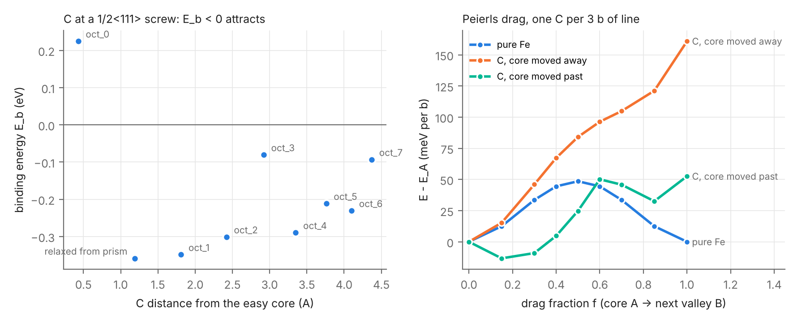

# Carbon at a screw dislocation in iron

Carbon and a 1/2<111> screw dislocation in bcc iron with the iron-carbon BOP
(`IRON_CARBON_FIT`, see [Iron-carbon](iron-carbon.md)), run on
[bopfox-rs](../bopfox-rs/README.md): potential self-consistency, exact
(implicit) forces, every mobile atom relaxed. Script:
`examples/carbon_screw_rs.py`; figure: `examples/plot_carbon_screw.py`, data
in `figures/carbon_screw.json`.



## Setup

- **Cell.** A cylinder of radius 13 A around a [111] line, 3 b (7.38 A)
  long and periodic along the line: 363 Fe atoms, one carbon atom per 3 b of
  line. The outer 6 A are held at the anisotropic elastic (Stroh) solution of
  the Egorov iron (a = 2.8394 A, C11/C12/C44 = 272/140/85 GPa), so 111 atoms
  near the core relax. Since the Fe-Fe part of the model is exactly the
  Egorov iron, the pure-iron results continue those of
  [Magnetic field](magnetic-field.md).
- **Binding energy.**
  `E_b = [E(dislocation + C) - E(dislocation)] - [E(perfect + C) - E(perfect)]`,
  all in the same cylinder, so the free and fixed surfaces cancel to first
  order; negative means attraction. The carbon reference is the octahedral
  site on the axis of the perfect cylinder.
- **States.** Every relaxed state is checked against cold starts with Fe
  moments 2.0 and 2.8 muB for a lower magnetic state (none was found);
  relaxations stop at 0.01 eV/A, or once 15 steps gain less than 2 meV with
  forces below 0.2 eV/A (the energy is then converged to about 1 meV).
- **Cost.** About 1-1.5 min per relaxation step on 2 cores (363 atoms), 0.5-2.5
  hours per configuration; the study took about a day on a 4-core machine.

## Binding energies

The 42 octahedral sites within 4.5 A of the easy core fall into 8 classes
under the symmetry of the core (classified on the elastic solution, which keeps
it exactly). One of each was relaxed with carbon. The hard core with carbon in
its prismatic site, the configuration DFT finds (Ventelon et al., PRB 91,
220102(R) (2015)), was reached by continuation (below).

| Start | C distance from the core after relaxation (A) | multiplicity | E_b (eV) |
|---|---|---|---|
| hard core, C in the prism, released | 1.19 | - | **-0.359** |
| oct_1 | 1.81 | 6 | -0.349 |
| hard core, C held at the prism centre | 1.19 | - | -0.336 |
| oct_2 | 2.42 | 6 | -0.301 |
| oct_4 | 3.35 | 3 | -0.290 |
| oct_6 | 4.10 | 6 | -0.231 |
| oct_5 | 3.76 | 6 | -0.211 |
| oct_7 | 4.37 | 6 | -0.093 |
| oct_3 | 2.92 | 6 | -0.081 |
| oct_0 | 0.43 | 3 | **+0.225** |

- **Carbon is attracted to a ring 1.2-2.5 A from the core**, by up to 0.36 eV,
  and repelled from the octahedral site at the core centre (+0.23 eV).
  The attraction is strongly site-dependent at the same distance (oct_3 at
  2.9 A: -0.08 eV, oct_4 at 3.4 A: -0.29 eV): the tetragonal carbon couples to
  the shear field of the screw through its orientation, not only to its
  distance.
- In every relaxed state carbon keeps a bulk-like environment (one or two Fe
  at 1.56-1.65 A, four or five at 1.95-2.1 A) and its bulk moment of
  -0.21 to -0.23 muB, and the core stays easy.
- Sites beyond about 3.5 A are within 3 A of the fixed shell; their values
  are less certain.

### No hard-core reconstruction in this model

In DFT, carbon turns the easy core into the hard core and sits in the centre
of the trigonal prism of Fe atoms it forms (six Fe neighbours), a strong
attraction. In this model:

- **The pure-iron hard core** is metastable, 91 meV/b above the easy core
  (above the Peierls barrier of 48 meV/b), so the 3 b cell pays 0.27 eV to
  form it.
- **Carbon in the prism.** Started at the centre of the elastic hard core
  (six Fe at 1.83 A) the self-consistency finds no solution. Moving carbon
  in along the line from a relaxed off-centre state (three Fe at 1.60 A,
  E_b = +1.05 eV) and relaxing the lattice wherever the self-consistency
  failed, then holding carbon at the prism centre and relaxing everything
  else, **the core slides 1.34 A back to the easy site**; carbon ends with one
  Fe at 1.57 A and five at 2.0 A, at E_b = -0.34 eV. Released, it relaxes to
  the deepest state found, -0.36 eV, still with an easy core.

The model therefore does not reproduce the reconstruction: the hard core with
carbon is not even metastable. The likely causes are in the fit: the Fe-C
core repulsion (125 eV below 1.70 A) and the Gaussian embedding at 2.0 A make
two short and four 2.0 A bonds (octahedral) or one short and five 2.0 A bonds
strongly preferred over six bonds at 1.8-1.9 A, and the hard core of the
Egorov iron is expensive. Cementite-like prisms (six Fe at 1.9-2.1 A) are
in the fit only through cementite itself.

## Peierls barrier and depinning

Drag calculations as in `examples/peierls_drag.py`: the core is moved from an
easy site A to the next one B on the (-110) plane (a sqrt(2/3) = 2.32 A
along x), the fixed shell at the elastic solution of the midpoint; at each
fraction f the z coordinates of the core columns (those that differ by more
than 0.2 A between A and B) are held at z_A + f (z_B - z_A) and everything
else, carbon included, relaxes. The energy along f is an upper bound of the
minimum energy path, and the stress of the steepest segment,
`tau = (dE/dx) / (b L)`, an estimate of the 0 K Peierls (depinning) stress of
the straight 3 b segment.

With carbon, two directions differ: carbon sits at (+0.9, +0.5..0.7) A from A,
so moving the core along -x leaves it behind ("away") and along +x moves the
core past it ("past"). End point B with carbon cannot be relaxed freely: a
core one valley from the carbon slides back to A without a barrier (so the
carbon captures the core from at least one valley away). B holds the core
columns at their pure-iron B positions.

| f | 0 | 0.15 | 0.3 | 0.4 | 0.5 | 0.6 | 0.7 | 0.85 | 1 |
|---|---|---|---|---|---|---|---|---|---|
| pure Fe (meV/b) | 0 | 12.5 | 33.6 | 44.5 | **48.5** | (mirror) | | | 0 |
| C, core moved away | 0 | 15.2 | 46.0 | 67.2 | 84.1 | 96.3 | 104.8 | 121.2 | 160.9 (held) |
| C, core moved past | 0 | **-13.3** | -9.1 | 4.7 | 24.8 | 50.1 | 45.8 | 32.5 | 52.6 (held) |

| | steepest segment | tau (GPa) |
|---|---|---|
| pure Fe | 0.15-0.3 | **1.6** |
| C, core moved away | 0.3-0.4 (0.85-1 with the held end: 3.0) | **2.4** |
| C, core moved past | 0.5-0.6 (0.4-0.5: 2.3) | **2.3-2.9** |

- **Pure iron.** The barrier, 48.5 meV/b, agrees with the bopjax drag in a
  1 b cylinder (47.0 meV/b; 12.5/33.6/44.5 against 10.7/31.9/42.9 meV/b at
  f = 0.15/0.3/0.4): the Rust port and the larger cell change it by 3 %.
  The coarse grid gives 1.6 GPa against 1.78 GPa from the finer profile.
- **Away from the carbon** the energy rises monotonically: there is no Peierls
  maximum within the first valley, the core must be pulled. Carbon adds
  0.11 eV (36 meV/b) at the Peierls saddle (f = 0.5) and 0.36 eV at f = 0.85.
- **Past the carbon** the carbon changes configuration twice, so the
  profile is the lower of three relaxations at each f: the forward drag, a
  backward one from f = 0.4 and one from B. Near A, carbon switches from two
  short Fe-C bonds to one (the state of the binding table), which is lower
  still with the core moved 0.35 A towards it (f = 0.15, -13 meV/b). Between
  f = 0.6 and 0.7 carbon moves by 0.4 A to stay next to the core (from
  (0.92, 0.70) to (1.20, 0.41) A), so the carbon follows the core instead of
  being passed.
- **The depinning stress of the 3 b segment** is about 2.3-2.9 GPa against
  1.6 GPa without carbon: +50 to +80 %.

### What this means for the CRSS

- One carbon per 3 b (one per 7.4 A of line) is a very high line
  concentration, and the segment is straight and pinned along its whole
  length. A real dislocation bows between carbon atoms, and the relevant
  quantity is the kink-pair enthalpy near a carbon atom, not the stress to
  move a straight segment. The numbers above are input to a solute
  strengthening model (binding energies vs. position, the energy profile of
  the core next to a carbon), not a CRSS.
- The trend is robust: carbon binds the screw by 0.3-0.36 eV over a ring of
  sites around the core, it captures a core one Peierls valley away, and
  dragging the core away from it raises the 0 K stress of a short segment by
  about 50-80 %. This is the right direction (carbon strengthens iron and
  pins screw dislocations, Cottrell atmospheres, static strain ageing).
- What DFT predicts beyond that, carbon reconstructing the core and moving
  with it in the prism, is missing from this model.

## Stress-driven Peierls stress: does not work in this cell

The first attempt applied a resolved shear stress sigma_yz on the (-110)
plane (the strain from the model's compliance, applied to every atom,
the fixed shell included) and raised it until the core moved. The core stayed
in its valley up to 2.8 GPa, with its columns moving by a few hundredths of
an angstrom: with 7 A of mobile region the fixed shell, which keeps the field
of a core at its original position, holds the core back by about
mu b d / (2 pi R^2) (0.7 GPa at half a valley). A stress-driven CRSS needs
flexible (Green's function) or periodic quadrupolar boundaries, or a much
larger cylinder.

## Limitations

- **Small cell.** 3 b along the line, 7 A of mobile region; binding energies
  move by up to 0.1 eV between cylinders whose boundary is centred at the core
  and at the drag midpoint.
- **Drag, not NEB.** The profiles are constrained paths (upper bounds) on a
  coarse grid; the carbon's own jumps between configurations are not
  resolved, so where branches cross the profile is a lower bound of that
  step.
- **Several carbon configurations.** Carbon next to the core has at least two
  states (two or one short Fe-C bond); the "away" path stays on the first,
  which may lie above the second near A by a few tens of meV.
- **Model.** The Fe-C cross terms were fitted to bulk properties only (see
  [Iron-carbon](iron-carbon.md)); the dipole tensor anisotropy is three
  quarters of DFT's, so the coupling to the shear field of the screw is
  likely too weak, and the hard-core reconstruction is absent.
- **No edge dislocations, no kink pairs, no temperature.**

## Running

```bash
OUT=runs/carbon_screw
for job in perfect easy perfect_C hard oct_0 oct_1 oct_2 oct_3 oct_4 oct_5 oct_6 oct_7; do
  uv run python examples/carbon_screw_rs.py $OUT run $job --fmax 0.01
done
# the prismatic site: an off-centre start, then continuation to the centre
uv run python examples/carbon_screw_rs.py $OUT run offcentre_hardC hard_C_held hard_C_free --fmax 0.01
# drags
R="uv run python examples/carbon_screw_rs.py $OUT run"
$R dragA dragB --fmax 0.01
$R dragpath --fmax 0.01 --no-ground-state --fractions 0.15 0.3 0.4 0.5
$R dragA_C dragB_C --fmax 0.01 && $R dragpath_C --fmax 0.01 --no-ground-state
$R dragAp dragBp dragA_Cp dragB_Cp --fmax 0.01 && $R dragpath_Cp --fmax 0.01 --no-ground-state
$R dragback_Cp --fmax 0.01 --no-ground-state --from-fraction 0.4
$R dragback_Cp --fmax 0.01 --no-ground-state --from-fraction 1.0 --back-suffix b --fractions 0.5 0.6 0.7 0.85
uv run python examples/carbon_screw_rs.py $OUT report
uv run python examples/plot_carbon_screw.py $OUT docs/figures/carbon_screw.png
```

Each job is written to `$OUT/<job>.npz` and skipped when present; interrupted
relaxations resume from `<job>.part.npz`. Jobs can run in parallel
(`RAYON_NUM_THREADS=2` each on 4 cores).
