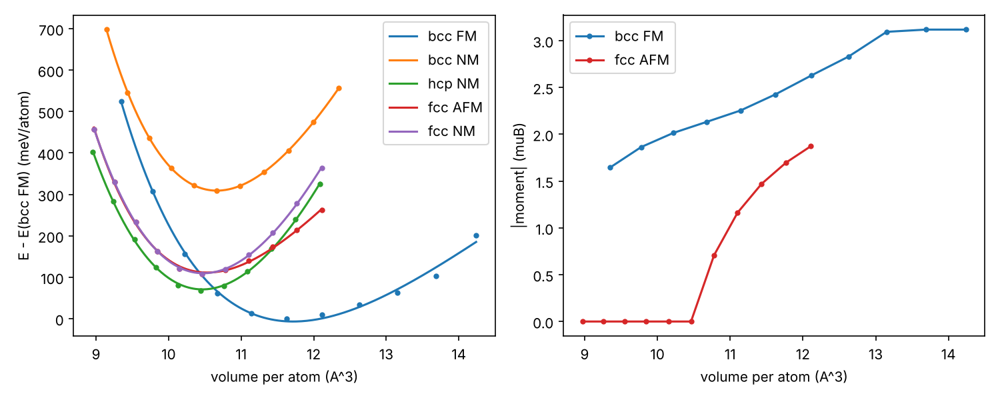
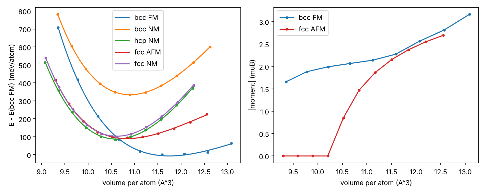

# Iron

Two iron models: the magnetic d-band BOP fitted here (`IRON_FIT`, and with an s
shell `IRON_SD_FIT`), and the Fe part of the Fe-Co BOP of Egorov et al.
(`iron_egorov`, [below](#the-egorov-et-al-fe-model-iron_egorov-iron_egorov_config)),
which is the one to use for dislocations.

A magnetic d-band BOP for Fe (`bopjax.models.iron`, `IRON_FIT`, `IRON_CONFIG`):
d electrons only, collinear Stoner magnetism, exponential bond integrals
(`v0_bond` without its short-range factor), an exponential pair repulsion and
square-root embedding, 9 moments, cutoff 3.4 A (bcc first and second
neighbours, close-packed first neighbours).

Parameters: `IRON_FIT`, fitted with `examples/fit_iron.py` (bounded least
squares, 10 parameters, about 2 hours on 4 cores). Full report:
`uv run python examples/iron_properties.py --figure iron.png` (about 15 minutes).

## Results

### Structural stability (each phase at its own equilibrium, hcp with relaxed c/a)

| Phase | a (A) | V (A^3) | E - E(bcc FM) (meV/atom) | moment (muB) | target (meV) |
|---|---|---|---|---|---|
| bcc FM | 2.854 | 11.62 | 0 | 2.43 | 0, 2.2 muB |
| hcp NM | 2.470, c/a 1.600 | 10.44 | **67** | 0 | 65 |
| fcc NM | 3.472 | 10.46 | 107 | 0 | 130 |
| fcc AFM | collapses to fcc NM at its equilibrium | | 107 | 0 | 100 |
| bcc AFM | 2.813 | 11.13 | 200 | 1.75 | |
| bcc NM | 2.773 | 10.67 | 309 | 0 | 480 |

The order matches DFT: bcc FM is the ground state, and hcp NM comes next at
67 meV/atom, then fcc, the bcc antiferromagnet and non-magnetic bcc. The
hcp FM and AFM and fcc FM starts collapse to the non-magnetic states.

### Elastic constants (GPa)

| | C11 | C12 | C44 | C' | A = C44/C' | B |
|---|---|---|---|---|---|---|
| bcc FM, model | 250.7 | 130.1 | 119.5 | 60.3 | 1.98 | 170.3 |
| bcc FM, experiment (4 K) | 243 | 138 | 122 | 52.5 | 2.32 | 173 |

hcp NM (next stable phase, atoms relaxed in every strained cell): C11 = 735,
C12 = 277, C13 = 279, C33 = 798, C44 = 127, C66 = 229, B = 438 GPa. These
were not fitted and are far too stiff: DFT gives a bulk modulus of
about 280-300 GPa for hcp Fe at this volume. The non-magnetic phases of
the model are generally too stiff (Birch-Murnaghan B0 of 400-410 GPa for
bcc NM, hcp NM and fcc NM).

### Magnetic stability

- bcc: FM is 309 meV/atom below NM, AFM (B2 order) only 109 meV below NM,
  so ferromagnetic order is clearly preferred (by 200 meV/atom).
- fcc and hcp: non-magnetic at their equilibrium volumes. The fcc AFM
  moment appears on expansion, above 10.5 A^3, and reaches 1.9 muB at
  12.1 A^3.
- bcc FM moment against volume: 1.65 muB at 9.4 A^3, 2.25 at 11.1, 2.63 at
  12.1, saturating at 3.1 (the d-band limit for 6.88 electrons) above 13 A^3.
- bcc FM -> hcp NM under pressure: **11.3 GPa** (common tangent), volume
  11.16 -> 10.18 A^3; experiment 13 GPa, GGA about 10 GPa.

## s and p shells (`iron(basis=...)`, `IRON_SD_FIT`)

`iron(basis=("s", "d"))` adds a 4s shell (onsite level `e_s` above the d
level, bond integrals `sss` and `sds` decaying with `decay_sp`); the Stoner
term acts on the d shell only and the 8 valence electrons (3d6 4s2) share one
Fermi level, so `n_d` is no longer a parameter. `pd` and `spd` bases are
supported by the model and `examples/fit_iron.py --basis` but were not fitted.

Which basis: with starting parameters the pd and spd models lost the bcc
moment and spd cost about 5-30 times more per equilibrium than d; sd kept the
moment and adds only three parameters, so sd was fitted. Starting from weak
s-d coupling and the d parameters (strong starting coupling collapses all
phases), `fit_iron.py --basis sd` was run twice (10 and 15 steps, 110 + 130
evaluations, about 12 hours on 4 cores). Same targets and tolerances as the
d model:

| Property | d (`IRON_FIT`) | sd (`IRON_SD_FIT`) | target |
|---|---|---|---|
| a bcc FM (A) | 2.854 | 2.855 | 2.855 |
| m bcc FM (muB) | 2.43 | **2.29** | 2.2 |
| C11, C12, C44 (GPa) | 251, 130, 120 | 253, 125, 125 | 243, 138, 122 |
| E hcp NM (meV) | 69 | 89 | 65 |
| E fcc AFM (meV) | 107 (collapses to NM) | **94, 1.47 muB** | 100 |
| E fcc NM (meV) | 107 | 101 | 130 |
| E bcc NM (meV) | 309 | 334 | 480 |
| V/V0 hcp NM, fcc NM | 0.899, 0.900 | 0.912, 0.911 | 0.90, 0.91 |
| cost (sum of squared residuals) | 59.4 | **43.5** | |

The sd model fits better (cost 43.5 against 59.4) and removes two limits of
the d model: the bcc moment comes down to 2.29 muB with a larger magnetic
energy of bcc (334 against 309 meV), so the two no longer pull against each
other as strongly, and fcc AFM is a stable antiferromagnet with a moment of
1.47 muB (DFT about 1-1.5) instead of collapsing. The s shell holds 1.18
electrons and carries -0.07 muB, antiparallel to the d moment (2.36 muB):
the sp polarisation of DFT (about -0.05 to -0.1 muB), induced through s-d
hybridisation without an s Stoner term and not fitted. The price is the
hcp energy (89 meV, target 65; the order bcc FM < hcp NM < fcc is kept) and
C12. The s-d coupling is moderate (`sds` = -0.26, `sss` = -0.30 eV at r0).
Each sd evaluation costs about 3 times a d evaluation.

### Energy-volume curves and moments of the sd model

`uv run python examples/iron_properties.py --basis sd --figure iron_sd.png`
(about an hour). Same phases and volume ranges as the d figure, except that
the bcc FM curve stops at 13.1 A^3: above that the sd self-consistency has
several solutions (for example a state with m = 4.0 muB, majority s and d
both full, 200-400 meV above the saturated ferromagnet) and does not always
find the lowest one. Each magnetic point is the lowest of several starting
moments.

- bcc FM moment (d + s) against volume: 1.66 muB at 9.4 A^3, 1.99 at 10.2,
  2.14 at 11.1, 2.56 at 12.1 and 3.16 at 13.1, where the majority d band is
  full; the same shape as the d model with a lower moment at equilibrium.
- fcc AFM keeps a moment down to 10.5 A^3 (0.85 muB) and is non-magnetic
  below 10.2 A^3; at its equilibrium (10.84 A^3) it has 1.47 muB and lies
  6.6 meV below fcc NM. Above 11.5 A^3 its moment is close to that of
  bcc FM.
- bcc AFM is magnetic (2.36 muB, 110 meV above bcc FM, 224 meV below bcc
  NM); hcp FM and AFM still collapse to hcp NM.
- bcc FM -> hcp NM under pressure: **15.6 GPa** (common tangent), volume
  11.11 -> 10.28 A^3 (d model 11.3 GPa, experiment 13 GPa). The
  Birch-Murnaghan fit of bcc FM is poor because of the moment change across
  the range (B0 = 216 GPa against the elastic B = 168 GPa), so this number
  is approximate.
- Elastic constants: bcc FM C11 = 253, C12 = 125, C44 = 125, B = 168 GPa;
  hcp NM (relaxed) C11 = 839, C12 = 285, C13 = 320, C33 = 939, C44 = 152,
  C66 = 278, B = 497 GPa, even stiffer than the d model (438). The
  non-magnetic phases have Birch-Murnaghan B0 of 450-470 GPa.

## The Egorov et al. Fe model (`iron_egorov`, `IRON_EGOROV_CONFIG`)

The Fe part of the magnetic Fe-Co BOP of Egorov, Subramanyam, Yuan, Drautz and
Hammerschmidt (arXiv:2208.12973, parameters in its Supplemental Table 1):
d-valent, 6.98 electrons, Stoner integral 0.751 eV, bond integrals as sums of
stretched exponentials (`pairwise.exp_sum`, cutoff 4.1 A, third neighbours
included), square-root embedding of Gaussian densities, pair and core
repulsion and an environment-dependent Yukawa repulsion
(`BOPConfig(yukawa=True)`, cutoff 6 A), 9 moments with a Jackson kernel, 200
expansion coefficients and a constant terminator. Use with
`radial=pairwise.exp_sum`.

Two choices the paper leaves open were fixed by reproducing its bcc Fe values:
the embedding prefactor p1 multiplies the square root (as Eqs. 6-7 read, inside
it, bcc Fe binds by -4.9 eV/atom at a = 3.05 A), and the bandwidth estimate is
`findeminemax` (with `averaged` the 200-term expansion grows without bound).
`hubbard` (8 eV) is not part of the published model.

| bcc FM | V (A^3) | moment (muB) | B | C11 | C12 | C44 (GPa) | E (eV/atom) |
|---|---|---|---|---|---|---|---|
| bopjax | 11.45 | 2.875 | 184 | 272 | 140 | 85 | -8.292 |
| paper | 11.45 | 2.88 | 185 | 269 | 147 | 90 | -8.31 (DFT) |

Compared with `IRON_FIT`, the Stoner integral is smaller (0.751 against 1.165
eV) and the dd-sigma bond integral about half as strong (-0.64 against -1.15 eV
at 2.48 A). Its screw dislocation core keeps the bulk moment within 1.5 % along
the whole Peierls path, where the core moment of `IRON_FIT` and `IRON_SD_FIT`
collapses (see [Magnetic field](magnetic-field.md)). A self-consistent energy
and force of 91 atoms costs about 5 s at fixed levels; use
`BOPConfig(remat=True)` for gradients of large cells (2 GB instead of 6 GB).

## Targets (`examples/fit_iron.py`)

| Property | Target | Tolerance | Source |
|---|---|---|---|
| a, bcc FM | 2.855 A | 0.005 | experiment, low temperature |
| moment, bcc FM | 2.2 muB | 0.05 | experiment |
| C11, C12, C44 | 243, 138, 122 GPa | 8 | experiment, 4 K (Rayne and Chandrasekhar, Phys. Rev. 122, 1714 (1961)) |
| E(hcp NM) - E(bcc FM) | 65 meV | 10 | DFT-GGA, rounded literature value |
| E(fcc AFM) - E(bcc FM) | 100 meV | 12 | DFT-GGA, rounded literature value |
| E(fcc NM) - E(bcc FM) | 130 meV | 12 | DFT-GGA, rounded literature value |
| E(bcc NM) - E(bcc FM) | 480 meV | 30 | DFT-GGA, rounded literature value |
| V(hcp NM), V(fcc NM) / V(bcc FM) | 0.90, 0.91 | 0.02 | DFT-GGA |

The DFT values are rounded figures from the literature (e.g. Mrovec et al.,
PRL 106, 246402 (2011)) and were not re-checked against the papers; replace
them with your own reference calculations where you have them.

## What `examples/iron_properties.py` reports

1. all nine phases (bcc, fcc, hcp; FM, AFM, NM) at their equilibrium, hcp
   with relaxed c/a, ordered by energy;
2. the elastic constants of the ground state and of the next stable phase
   (hcp with internal relaxation);
3. magnetic energies of each lattice and the moment of bcc FM against volume;
4. the bcc FM -> hcp NM transition pressure (experiment 13 GPa).

## Known limits

- fcc AFM and the magnetic hcp states collapse to non-magnetic solutions;
  DFT gives fcc AFM a moment of about 1-1.5 muB.
- The moment (2.43 muB) and the magnetic energy of bcc (309 meV against
  480) pull against each other in the Stoner model: a larger Stoner
  integral raises both. The fit compromises between them.
- fcc AFM has no moment at its equilibrium, where DFT gives it about
  1-1.5 muB, so fcc AFM and fcc NM are the same state.
- The non-magnetic phases are too stiff (see above); only bcc FM elastic
  constants were fitted.
- A bcc FM equation of state over a wide volume range has a kink where the
  moment saturates; use the elastic B = 170 GPa, not the Birch-Murnaghan
  value.
- The moment is the d moment of the Stoner model; there is no sp polarisation
  or orbital moment.
